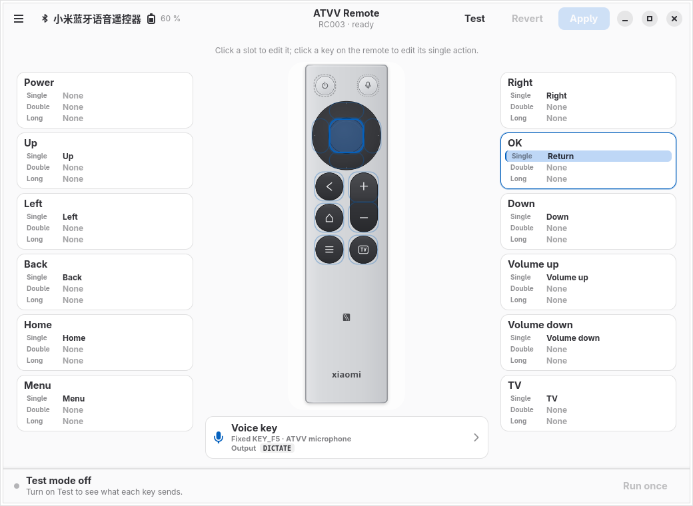

# atvv-linux

[English](README.md) | **简体中文**

[](https://github.com/YangtseSu/atvv-linux/actions/workflows/ci.yml)
[](https://github.com/YangtseSu/atvv-linux/releases)
[](https://aur.archlinux.org/packages/atvv)
[](LICENSE)
[](#安装arch)

面向 Linux 的 ATVV v1.0 用户态栈：把 BLE 语音遥控器变成 PipeWire 麦克风，并提供
evdev/uinput 按键映射和 D-Bus 控制接口。

本项目不是内核驱动、BlueZ 插件或 PipeWire 模块。BlueZ 负责配对、GATT 和 HID；
用户态守护进程负责 ATVV；PipeWire 负责音频图；evdev/uinput 负责输入重映射。



## 状态

ATVV v1.0 采集、输入重映射、守护进程和 D-Bus API、CLI、MCP 服务器以及可选的
GTK 配置应用均已实现。RC003 和 Google Chromecast Remote 音频路径均已实现并有
真实设备运行记录（Chromecast A0 固件的运行仍待完成）；证据见下文
链接。

fcitx5-vinput 的自动设置由上游负责：维护者在其架构重构期间关闭了 ATVV 的
提案 PR，并会在自己的设计中实现自动选择和声明键绑定。在发布版提供该功能之前，
请按名称选择 ATVV 源并手动添加声明的触发键；见
[fcitx5-vinput 指南](docs/integrations/fcitx5-vinput.zh-CN.md)。

已实现：

- `atvv-protocol`：v1.0 能力解析、控制事件、ADPCM、帧累积、设备配置文件和纯
  会话状态机。
- `atvv-audio`：原生 PipeWire `Audio/Source`，带容量受限的无锁队列、合成音测试
  和节点移除恢复。消费者链接时源会被唤醒（`node.pause-on-idle=false`）；PipeWire
  服务重启由 systemd 单元负责（ADR 0005）。
- `atvv-input`：由配置文件驱动的 evdev 发现和 `EVIOCGRAB`、按配置文件的手势时序、
  uinput 虚拟键盘，以及为被独占的语音键配置合成触发键/组合键。
  `atvvctl input fake-remote` 无需硬件即可走完整条路径。
- `atvv-config`：唯一的 `daemon.toml` 模式解析器（带已知设备注册表和按设备布局的
  模式 v3）、带版本号的 JSON 配置文档、按按键校验操作、手势覆盖、`exec:` 策略，
  以及带应用验证预设（mpv、LibreOffice Impress/WPS 演示、omp）的命名布局。实时
  改动通过 `atvvctl config` 或 D-Bus `SetConfig` 方法应用。
- `atvv-bluez`：BlueZ GATT 传输（`bluer`）、适配器/设备选择、带 `StartNotify`
  回退的 `AcquireNotify`、会上报 PnP id 供配置文件推断的配对代理，以及重连处理。
- `atvv-daemon` / `atvvd`：`Transport` trait 之后的会话编排、mock 与 BlueZ
  传输、定时器、PCM 解码、常驻 PipeWire 源、语音键边沿麦克风控制、触发键和
  `org.fcitx.Vinput` 模式、输入层、带按设备布局和设备注册表的切换（配置文件变化
  时重建源），以及 `org.atvv.Daemon` 上的 JSON 视图模型。
- `atvvctl`：配置文件查看、CAPS 解码、无硬件的会话模拟、音频源冒烟测试、
  假输入遥控器，以及 `status`、`contract`、`mic start|stop|toggle`、`reload`、
  `config get|set`、`capture`、`map test`、`layout list|show|use|preset`、
  `device list|use|rename`、`pair`、`record`、`monitor` 和 `doctor`。
- `atvv-mcp`：stdio MCP 服务器，提供 `status`、`contract`、`voice_start`、
  `voice_stop`、`voice_toggle`、`list_devices`、`devices`、`select_device`
  和 `reload`。
- `atvv-gui` / `atvv-config`：GTK4 + libadwaita 配置应用，包含可点击的遥控器
  示意图、按槽位的操作编辑器、带应用验证预设的布局管理器、键盘和遥控器按键学习、
  录音键输出选择、测试模式和脚本策略。界面跟随桌面语言环境：英文，`zh*` 语言环境
  使用简体中文。它只是 D-Bus 客户端；见
  [`docs/gui.zh-CN.md`](docs/gui.zh-CN.md)。

第一个配置文件是小米蓝牙语音遥控器 2 Pro（`miremote-rc003`，ATVV v1.0，
16 kHz ADPCM，120 字节帧）。2026-10-30 的运行（`C0:5D:39:F8:2D:4C`）验证了
真实 CAPS、音频、保活和重连；确切证据和剩余缺口（配对手势、可懂度、已安装单元
的 PipeWire 重启）见
[`docs/research/rc003-hardware-evidence.md`](docs/research/rc003-hardware-evidence.md)。

第二个配置文件是 Google Chromecast Remote（`google-chromecast`，USB
`18d1:9450`，DIS 型号 `A3`，ATVV v1.0，16 kHz ADPCM，240 字节帧）。2026-11-02
的运行（`74:46:B3:22:2D:D5`）验证了配对推断、CAPS、音频和裸 `MIC_EXTEND` 保活；
A0 固件的运行仍待完成。证据和正版判断见
[`docs/research/chromecast-hardware-evidence.md`](docs/research/chromecast-hardware-evidence.md)。

## 安装（Arch）

要求：Arch Linux、systemd 用户会话、PipeWire、BlueZ，以及（语音键集成所需的）
fcitx5-vinput。守护进程是用户服务；不要以 root 运行。可选的 `atvv-gui` 软件包
额外需要 GTK4、libadwaita 和 librsvg。

AUR 软件包从发布源码归档构建：

```sh
git clone https://aur.archlinux.org/atvv.git
cd atvv
makepkg -si
```

该仓库是一个拆分的 pkgbase：会构建 `atvv` 和可选的 `atvv-gui`，`makepkg -si`
会安装两者。只安装守护进程和 CLI 用 `makepkg -si --pkg atvv`；AUR 上没有单独的
`atvv-gui` 仓库。`atvv-gui` 依赖 `atvv`，AUR 助手会解析该顺序。GUI 应用是可选的；
守护进程和 CLI 不依赖 GTK。

先配对遥控器，再启用用户服务：

```sh
atvvctl pair C0:5D:39:F8:2D:4C        # RC003
atvvctl pair 74:46:B3:22:2D:D5        # Chromecast Remote
systemctl --user daemon-reload
systemctl --user enable --now atvvd
atvvctl doctor
```

`atvvd` 通过 PipeWire 提供 `atvv-<profile>`（`atvv-miremote-rc003` 或
`atvv-google-chromecast`）。在 fcitx5-vinput 中按名称选择它（见
[`docs/integrations/fcitx5-vinput.zh-CN.md`](docs/integrations/fcitx5-vinput.zh-CN.md)）；
不要把它设为系统默认设备。使用 `atvvctl device use <MAC>` 在已知设备间切换并
重新加载各自的布局。

按键映射、手势时序、`exec:` 启用方式和实时 `SetConfig` 路径记录在
[`docs/configuration.zh-CN.md`](docs/configuration.zh-CN.md)。

软件包安装 `/usr/bin/{atvvd,atvvctl,atvv-mcp}`；
`/usr/lib/systemd/user/atvvd.service`；
`/usr/lib/udev/rules.d/70-atvv-linux.rules`（对 RC003、Chromecast 事件节点和
`/dev/uinput` 使用 `uaccess`）；`/usr/lib/modules-load.d/atvv-linux.conf`
（`uinput`）；man 手册；以及 bash/zsh/fish 补全。不安装系统级 D-Bus 策略：
守护进程使用会话总线。

## 故障排查

| 症状 | 检查 |
|---|---|
| `cannot connect to the session D-Bus` | `systemctl --user status atvvd`；`systemctl --user enable --now atvvd` |
| `The name is not activatable` | `atvvd` 未运行；检查 `systemctl --user status atvvd`。守护进程在遥控器断开时保持运行并重试链接。 |
| `no device address` | `atvvctl pair <MAC>` 会写入 `~/.config/atvv/daemon.toml` |
| 音频源缺失 | `pw-cli info atvv-miremote-rc003` 或 `atvv-google-chromecast`；`atvvctl doctor` |
| `uinput` 不可写或按键未被独占 | `/dev/uinput` 存在且可写；`uinput` 模块已加载；安装 udev 规则后重新登录 |
| 遥控器未连接或缺少 CAPS | `bluetoothctl info <MAC>`；`atvvctl doctor`；`atvvctl monitor` |
| 语音键没有触发 fcitx | 守护进程默认 `trigger_key = "DICTATE"`。保留用户的 `[TriggerKey]` 条目并添加 `1=Dictate`；编辑前停止 fcitx5，编辑后**完全重启** fcitx5。`fcitx5-remote -r` 不够，旧的触发列表可能仍然生效。整段注释掉的 `[TriggerKey]` 会禁用触发。`F24` 是回退键。 |
| F5 传到了当前应用 | 遥控器节点未被独占；检查 `atvvctl status` 中的 `input.grabbed`，并关闭其他独占程序 |
| PipeWire 重启后没有音频源 | `PartOf=pipewire.service` 会重启 `atvvd`；检查 `atvvctl status` 和 `pw-cli info` |
| 音频源存在但 fcitx 未列出 | 音频源出现后重启 `vinput-daemon` |

每种症状的完整恢复路径（含精确命令、预期输出和日志特征）见
[`docs/troubleshooting.zh-CN.md`](docs/troubleshooting.zh-CN.md)。

## 已知限制

- RC003 的麦克风只在按住实体语音键时传输数据；仅由主机发出 `MIC_OPEN`
  不会产生音频帧（[证据](docs/research/rc003-hardware-evidence.md)）。
- 默认 `preopen_mic = false` 时，RC003 从按下语音键到首个解码帧约需 0.2 秒
  （中位数 157 ms，2026-11-03 实测）。`preopen_mic = true` 通过保持 BLE 会话
  待命消除这段设备侧延迟；见
  [配置](docs/configuration.zh-CN.md#预打开麦克风)。
- fcitx5-vinput 尚未自动选择音频源或绑定声明的按键；请手动配置
  （[指南](docs/integrations/fcitx5-vinput.zh-CN.md)）。
- Chromecast 遥控器 A0（`G9N9N`）固件尚未在 Linux 上运行；A3 的运行记录见
  [证据](docs/research/chromecast-hardware-evidence.md)。
- ATVV 不执行 ASR。识别和文本提交由消费者负责。
- 增益默认为 0 dB，可能削波；请在 GUI 中或使用
  `atvvctl config set --gain-db` 调整。

设备支持和真实设备记录见
[`docs/device-support.zh-CN.md`](docs/device-support.zh-CN.md)、
[`docs/research/rc003-hardware-evidence.md`](docs/research/rc003-hardware-evidence.md)
和
[`docs/research/chromecast-hardware-evidence.md`](docs/research/chromecast-hardware-evidence.md)。

## 构建与测试

```sh
cargo test --workspace
cargo run -q -p atvv-cli -- profile show miremote-rc003
cargo run -q -p atvv-cli -- caps decode 0B010002000078
cargo run -q -p atvv-cli -- simulate miremote-rc003
cargo run -q -p atvv-cli -- audio test --seconds 3
cargo run -q -p atvv-cli -- input fake-remote
dbus-run-session -- cargo run -q -p atvv-daemon -- --mock
cargo run -q -p atvv-cli -- status
cargo run -q -p atvv-cli -- config get --json
cargo run -q -p atvv-cli -- config set --button up --trigger single --action key:KEY_F13
cargo run -q -p atvv-cli -- map test --button up --trigger single
cargo run -q -p atvv-cli -- capture --timeout 10
cargo run -q -p atvv-cli -- doctor
cargo run -q -p atvv-cli -- pair C0:5D:39:F8:2D:4C
cargo run -q -p atvv-daemon -- --device C0:5D:39:F8:2D:4C --verbose
cargo run -q -p atvv-cli -- record --wav /tmp/rc003.wav --seconds 10
cargo run -q -p atvv-cli -- monitor
cargo run -q -p atvv-mcp
cargo run -q -p atvv-gui
```

## 目录结构

```text
crates/atvv-protocol/   协议、ADPCM、帧、设备配置文件、会话状态
crates/atvv-config/     daemon.toml 模式、校验、JSON 配置文档
crates/atvv-audio/      原生 PipeWire Audio/Source 和 PCM 队列
crates/atvv-input/      evdev 发现/独占、手势、uinput 键盘
crates/atvv-bluez/      BlueZ GATT 传输和配对代理
crates/atvv-daemon/     atvvd 会话守护进程、mock 传输、D-Bus API
crates/atvv-cli/        atvvctl 诊断和 D-Bus 控制
crates/atvv-mcp/        面向 agent 的 stdio MCP 服务器
crates/atvv-gui/        GTK4/libadwaita 配置应用（atvv-config）
packaging/              systemd 用户单元、udev 规则、GUI 桌面元数据
docs/plans/             规范实现计划和验收标准
docs/decisions/         架构决策
docs/research/          领域调研、协议事实、参考快照
docs/integrations/      fcitx5-vinput 和编码 agent 配置
docs/handoff.md         下一次会话的当前状态
```

## 范围

范围内：ATVV v1.0+、Linux、BlueZ、PipeWire、evdev/uinput、D-Bus、
fcitx5-vinput、编码 agent 集成、设备配置文件、打包。

暂不在范围内：ATVV v0.4、ASR 引擎、非官方云协议、非 ATVV 传输、
内核/BlueZ/PipeWire 补丁、macOS/Windows。

## 致谢

本项目在开发过程中参考了若干开源项目。来源、固定快照、许可证和复用边界列在
[`docs/research/reference-projects.md`](docs/research/reference-projects.md)。

## 许可证

GPL-3.0-or-later。见 `LICENSE`。
