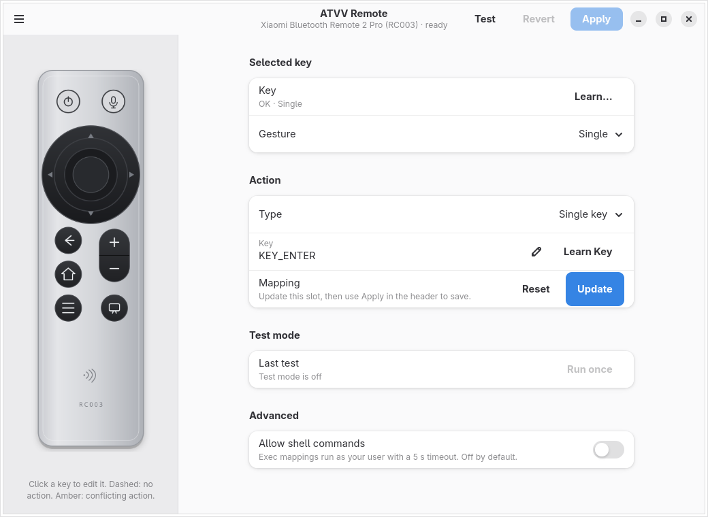

# Configuration GUI

`atvv-config` is the GTK4/libadwaita configuration client for `atvvd`
([ADR 0008](decisions/0008-gui-toolkit.md)). It edits the button map through
the daemon's `GetConfig`/`SetConfig` API and uses `BeginCapture`/`RunAction`
for test mode. It never writes `daemon.toml`, opens evdev/uinput, or talks to
BlueZ or PipeWire directly.



## Install and start

The GUI is the optional `atvv-linux-gui` package; the daemon package does not
depend on GTK.

```sh
sudo pacman -S atvv-linux atvv-linux-gui
systemctl --user enable --now atvvd
atvv-config
```

Without a running daemon the window opens a read-only *Daemon unavailable*
page with a Retry button. The daemon stays headless; `atvvctl` remains the
scriptable surface.

## Window

- **Remote diagram**: one real button per logical key, drawn as the RC003
  layout: power and voice at the top, a circular D-pad, back/home/menu on the
  left, and the volume rocker plus TV on the right. The top-right voice key is
  not remappable. Click a key to edit it; the outline shows bound (solid),
  unbound (dashed), and conflicting (amber) mappings. The selected key uses
  the system accent color.
- **Selected key**: shows the current key and gesture. *Learn…* starts the
  daemon's capture mode and selects the physical remote key that is pressed.
- **Action**: type, value, and dictation controls for the selected slot.
  *Learn Key* captures a keyboard key or chord without leaving the window.
- **Test mode**: press a physical key, see the action that would run, and run
  it once on request.
- **Advanced**: the `allow_exec` policy.

The layout is an `AdwNavigationSplitView`: at narrow widths the diagram and
editor become separate pages, and selecting a hotspot opens the editor.

## Edit a mapping

1. Click a key in the diagram.
2. Choose **Single**, **Double**, or **Long**.
3. Choose the action type:
   - *Do nothing* swallows the button (`none`).
   - *Single key* emits one key, for example `KEY_F13`.
   - *Key combination* emits a chord, for example `ctrl+alt+v`.
   - *Run a command* runs `exec:<command>` through the daemon.
   - *Dictation* starts, stops, or toggles the ATVV microphone.
4. Type the value or use **Learn Key**. Modifiers held while learning become
   part of the chord in the order `ctrl`, `alt`, `shift`, `super`.
5. Click **Update**, then **Apply** in the header.

**Apply** validates the complete document, applies it to the running daemon,
and writes the file atomically. Invalid input stays in the editor with an
inline error, and the previous map remains active. **Reset** restores the
profile default for the selected slot. **Revert** discards unsaved edits by
reloading the daemon document.

## Test mode

Toggle **Test** in the header. The daemon reports logical button events while
capture is active; the window highlights the pressed key, shows the resolved
action, and enables **Run once**. Shell commands require a separate
confirmation dialog with Cancel as the default response.

Capture ends when Test is toggled off, **Cancel** is clicked in the banner, or
the GUI's bus connection disappears. The GUI never reads input devices; the
daemon owns the evdev grab, the action map, and capture state.

## Script safety

`exec:` is disabled unless `allow_exec = true`. Enabling it in **Advanced**
requires an explicit confirmation. The daemon runs the command as the user
with a 5 s timeout, closed stdio, one command at a time, and refuses to run
when its effective uid is 0. The GUI does not interpret shell syntax; review
the command before enabling it.

## Keyboard and accessibility

Every hotspot is a focusable `GtkButton` with an accessible name and tooltip.
Use Tab/Shift+Tab to move between keys and the editor, Enter/Space to select.
Focus rings, the system light/dark theme, and system accent colors come from
libadwaita; the diagram asset itself is theme-neutral.

## Persistence

The daemon writes the mapping to `$XDG_CONFIG_HOME/atvv/daemon.toml` (default
`~/.config/atvv/daemon.toml`). The same document is available through
`atvvctl config get --json`, `atvv-mcp`, and the daemon's D-Bus API, so the GUI
is not a second source of truth. The map survives daemon restarts.

## Limits

- One device profile at a time; the window shows the profile reported by the
  daemon.
- No per-application layers or automatic shortcut discovery.
- No ASR or cloud protocol in the app; dictation only drives the ATVV session.
- The GUI is optional. `atvvd`, `atvvctl`, `atvv-mcp`, and consumers such as
  fcitx5-vinput work without it.
