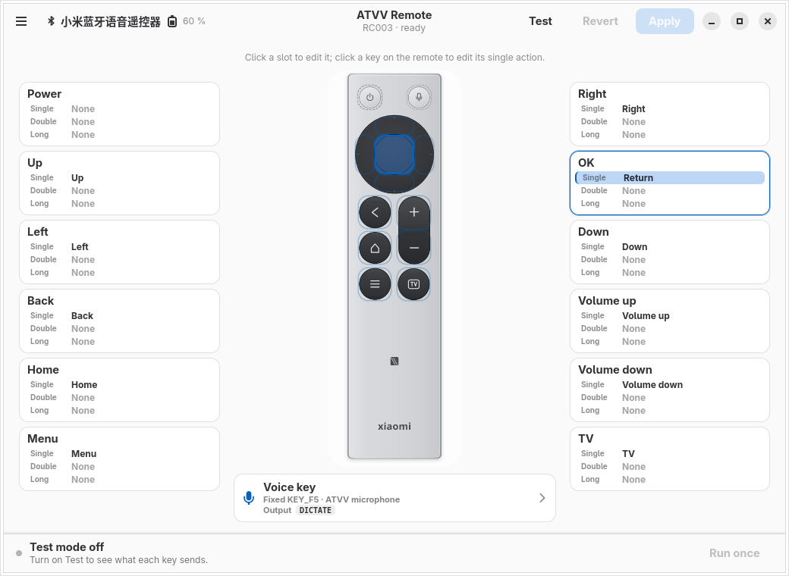
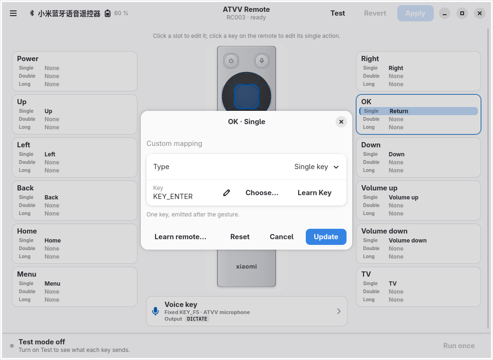
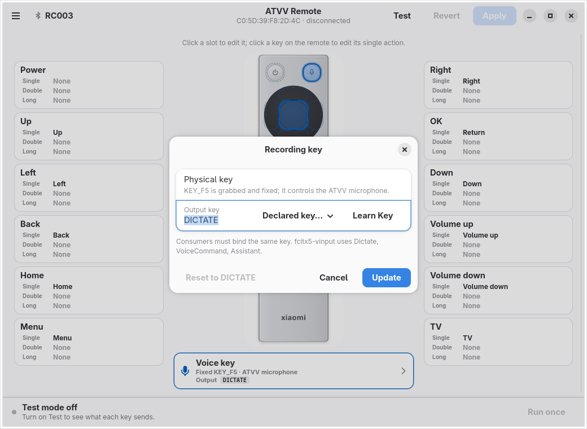

# Configuration GUI

English | [简体中文](gui.zh-CN.md)

`atvv-config` is the GTK4/libadwaita configuration client for `atvvd`
([ADR 0008](decisions/0008-gui-toolkit.md)). It edits the button map through
the daemon's `GetConfig`/`SetConfig` API and uses `BeginCapture`/`RunAction`
for test mode. It never writes `daemon.toml`, opens evdev/uinput, or talks to
BlueZ or PipeWire directly.



## Install and start

The GUI is the optional `atvv-gui` AUR package; the daemon package does not
depend on GTK.

```sh
git clone https://aur.archlinux.org/atvv-gui.git
cd atvv-gui
makepkg -si
systemctl --user enable --now atvvd
atvv-config
```

Install `atvv` first; `atvv-gui` depends on it. An AUR helper resolves the
dependency.

Without a running daemon the window opens a read-only *Daemon unavailable*
page with a Retry button. The daemon stays headless; `atvvctl` remains the
scriptable surface.

## Language

The app follows the desktop locale. English is the default and the fallback;
any `zh*` locale selects Simplified Chinese. There is no in-app language
switch. Restart `atvv-config` after changing the desktop language.

## Mapping board

The window is a three-column board around the original RC003 vector diagram:

- Left cards: Power, Up, Left, Back, Home, Menu.
- Center: the remote diagram and the voice-key card.
- Right cards: Right, OK, Down, Volume up, Volume down, TV.

Every card shows its three gesture slots, **Single**, **Double**, and
**Long**, with the resolved action in compact form (`Return`, `F13`,
`Ctrl+Alt+V`, `Left click`, `Pointer up 1`, `Command…`, `Start dictation`, or
`None`). The selected card and
slot use the system accent color. A slot with no action is dimmed, and a card
whose slot sends the same action as another card in the same gesture is
outlined in amber.

Click a slot to edit that exact slot. Click a key on the diagram to select the
card and edit its **Single** slot; the diagram and the card always show the
same selection. The board scrolls horizontally when the window is narrower
than the board; the header and the test bar stay visible.

The voice key in the top-right of the diagram is not an action slot. Clicking
it, or the **Voice key** card under the diagram, opens the recording-key
dialog.

## Header

- **Menu**: *Device information…*, *Revert changes*, *About ATVV*, and *Quit*.
- **Device chip**: the name BlueZ reports for the remote (the user-editable
  alias, for example the remote's own name) and the battery level. Without a
  BlueZ name it falls back to the profile display name and model. It opens the
  read-only *Device information* dialog with the name, battery, remote address,
  and the Device Information Service facts (firmware, hardware and software
  revisions, serial number, manufacturer, model). Rows without a value are
  hidden; a disconnected battery reads `last known`.
- **Layout chip**: the active layout name. It opens the layout switcher, which
  lists every layout and opens the manager.
- **Subtitle**: the profile model (`RC003`) and the session state. The
  Bluetooth address lives in the device information dialog.
- **Test**, **Revert**, and **Apply**.

The device chip covers the one active device. Switching between known remotes
and per-device layouts belongs to step 21, so this step opens device
information instead of a device list.

## Layouts

A layout is a named set of button actions and gesture timing. The layout chip
next to the device chip shows the active layout and opens a switcher. Its
popover lists every layout with an active check mark and description;
**Default** carries a *Template* tag. **Manage layouts…** opens the manager.

`Default` is synthesized from the device profile and is a template. It is
editable: slot and hotspot clicks open the normal editor and stage the change
in a working copy. The dirty banner reads "Unsaved changes on Default — Apply
saves them as a new layout." **Apply** opens **Save as layout** instead of
writing the template; the name, description, and staged map create a new user
layout that becomes active. **Revert** discards the staged edits and leaves
Default active.

User layouts can be created, renamed, duplicated, reset, and deleted from the
manager. Names are unique case-insensitively and 1–40 characters long;
`Default` and the preset ids `media`, `coding`, and `slides` are reserved. At
most 32 user layouts fit. Clicking a manager row switches layouts; the trailing
menu offers Duplicate, Rename, Delete, and Reset. Default offers Duplicate only,
and Delete is disabled for the active layout. Rename and **New layout…** use an
inline name/description form. While the document is dirty the footer shows
**Revert** and **Apply**.

Switching is blocked while the document is dirty: apply or revert first.
Switching calls `SetLayout`, applies the map and gesture timing live, and keeps
Test mode active while clearing the last pressed result. A failed switch keeps
the previous layout and shows the error.

Global settings (device, gain, vinput mode, recording key, exec policy) do not
belong to a layout, and the diagram and hotspot geometry do not change per
layout. The selected layout is persisted as `active_layout`; the Default
template is never stored in `daemon.toml`.

## Edit a mapping



1. Click a card slot, or a key on the diagram for its Single slot. The
   **Mapping** dialog opens for that button and gesture and shows whether the
   slot is a custom mapping, a profile default, or unbound.
2. Choose the action type:
   - *Do nothing* swallows the button (`none`).
   - *Single key* emits one key, for example `KEY_F13`.
   - *Key combination* emits a chord, for example `ctrl+alt+v`.
   - *Run a command* runs `exec:<command>` through the daemon.
   - *Dictation* starts, stops, or toggles the ATVV microphone.
   - *Pointer* clicks a mouse button (left, right, middle, side, extra,
     forward, back, or task) or moves the pointer up, down, left, or right by
     1–255 relative counts.
3. Type the value, use **Learn Key**, or use **Choose…** for a searchable
   list of every key the input backend supports, with its friendly label and
   kernel name. The picker inserts the
   chosen key; in a chord it replaces only the final key and keeps the
   modifiers. Search matches the canonical name, the localized label, and the
   English label, and ignores spaces/separators (`print`, `printscreen`,
   `key_sysrq`), so an English query works in every locale. Print Screen is
   `KEY_SYSRQ`. Modifiers held while learning
   become part of the chord in the order `ctrl`, `alt`, `shift`, `super`.
4. Click **Update**. The dialog closes, the board shows the new action, and
   **Apply** in the header becomes active. While Default is active the edit is
   staged as described under Layouts.

A **Pointer** action selects a click button or a movement direction and unit
count; units are relative counts, and the desktop's pointer acceleration and
speed settings still apply. Use the three gesture slots for distance, for
example `Up` → Single `Pointer up 1`, Double `Pointer up 10`, Long
`Pointer up 50`. The daemon creates `atvv-virtual-pointer` only while the
saved map contains a pointer action. Raw `BTN_*` values are rejected; use the
pointer editor.

**Learn remote…** starts the daemon's capture mode; pressing a physical remote
key retargets the dialog to that button and gesture. **Reset** restores the
profile default for the slot, and **Cancel** discards the dialog's edits.

**Apply** validates the complete document, applies it to the running daemon,
and writes the file atomically. When Default has staged slot edits, Apply opens
**Save as layout** instead; a document that only changed the layout list is
written in place. Invalid input stays in the dialog with an inline error, and
the previous map remains active. **Revert** discards unsaved edits by reloading
the daemon document.

## Recording key

The top-right microphone key is the physical recording key (`KEY_F5`). It is
grabbed and fixed: it opens and closes the ATVV microphone and cannot be used
as a normal action button. The recording-key dialog only edits the output key.



- **Output key** is the synthetic key emitted while the recording key is held.
  The default is `DICTATE`; use **Learn Key** to capture another key or chord
  (for example `F23`), or enter `none` to disable the synthetic key.
- **Declared key…** lists the recording keys advertised by the running
  daemon's contract (`DICTATE`, `VOICECOMMAND`, `ASSISTANT`) plus
  **None (disable synthetic key)**. The list comes from
  `StatusView.contract.recording_keys`, not a GUI copy. Choosing an entry fills
  the output field; the normal **Update** and **Apply** path still validates
  and saves it.
- The dialog shows the consumer name mapping (`Dictate`, `VoiceCommand`,
  `Assistant` for fcitx5-vinput) and warns when `vinput` is `dbus` or `off`,
  because those modes do not emit the synthetic key. Consumers must bind the
  same key; the provider contract's `active_key` reports the current value.
- **Update** changes the document; **Apply** in the header persists it through
  `SetConfig`. **Reset to DICTATE** restores the default. The physical F5 and
  the ATVV microphone path are unchanged.

## Test mode

Toggle **Test** in the header. The daemon reports logical button events while
capture is active; the pressed card slot is highlighted, the bottom bar shows
the button, its gesture, and the resolved action, and **Run once** becomes
available. Capture suppresses automatic key/chord emission, `exec`, dictation,
the synthetic voice trigger, and voice-session start/stop, so pressing OK or a
volume key does not activate the focused app or change system volume. The
voice key is reported as fixed; it does not start the microphone in Test mode.
Shell commands require a separate confirmation dialog with Cancel as the
default response.

Switching layouts keeps Test mode active but clears the last pressed result.
Capture ends when Test is toggled off, **Cancel** is clicked in the banner, or
the GUI's bus connection disappears. The GUI never reads input devices; the
daemon owns the evdev grab, the action map, and capture state.

## Script safety

`exec:` is disabled unless `allow_exec = true`. Enable **Allow shell commands**
in the action dialog; doing so requires an explicit confirmation. The daemon
runs the command as the user with a 5 s timeout, closed stdio, one command at a
time, and refuses to run when its effective uid is 0. The GUI does not
interpret shell syntax; review the command before enabling it.

## Keyboard and accessibility

Every card slot is a focusable `GtkButton` with an accessible name and tooltip.
Tab order follows the board; Enter or Space opens the focused slot. The action
dialog traps focus while open and returns it to the slot on close; Enter
activates **Update** and Escape cancels. Focus rings, the system light/dark
theme, and the system accent color come from libadwaita; the diagram asset
itself is theme-neutral.

## Persistence

The daemon writes the active layout, every user layout, and the global settings
to `$XDG_CONFIG_HOME/atvv/daemon.toml` (default
`~/.config/atvv/daemon.toml`). The same document is available through
`atvvctl config get --json`, `atvv-mcp`, and the daemon's D-Bus API, so the GUI
is not a second source of truth. The active layout survives daemon restarts.

## Limits

- One device profile at a time; the window shows the profile reported by the
  daemon.
- Device switching and per-device layouts belong to step 21; the layout chip
  switches layouts for the one active device. The board follows the interface
  reference except for the device switcher popover, the editor's raw-value
  preview line, and connector arrows between cards and the diagram.
- No per-application layers or automatic shortcut discovery.
- No ASR or cloud protocol in the app; dictation only drives the ATVV session.
- The GUI is optional. `atvvd`, `atvvctl`, `atvv-mcp`, and consumers such as
  fcitx5-vinput work without it.
