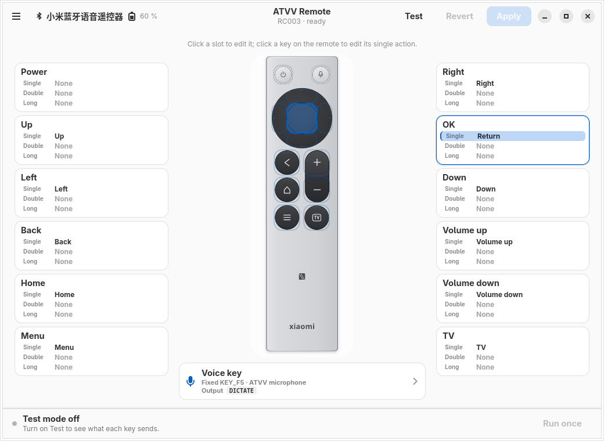
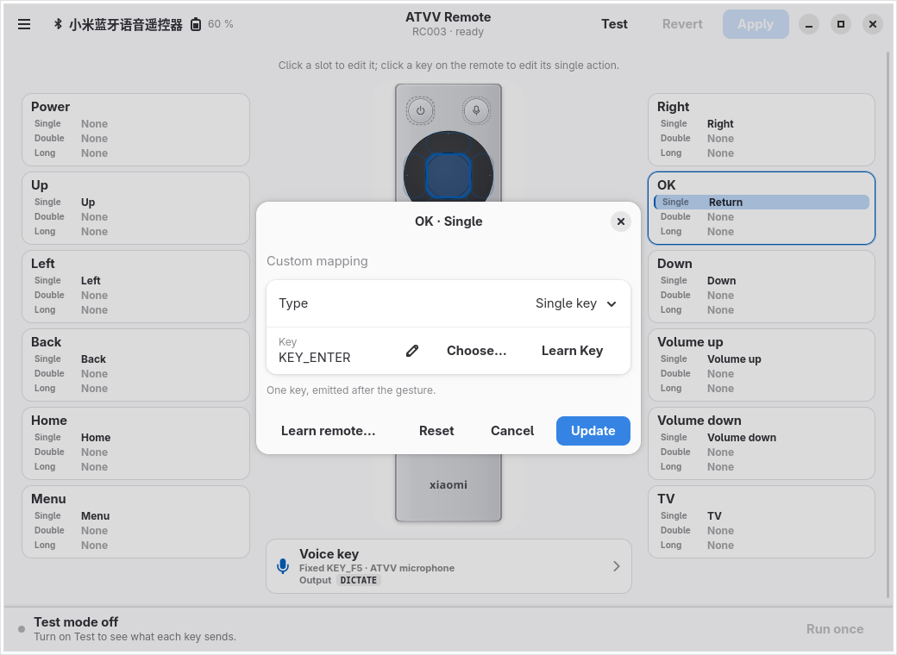
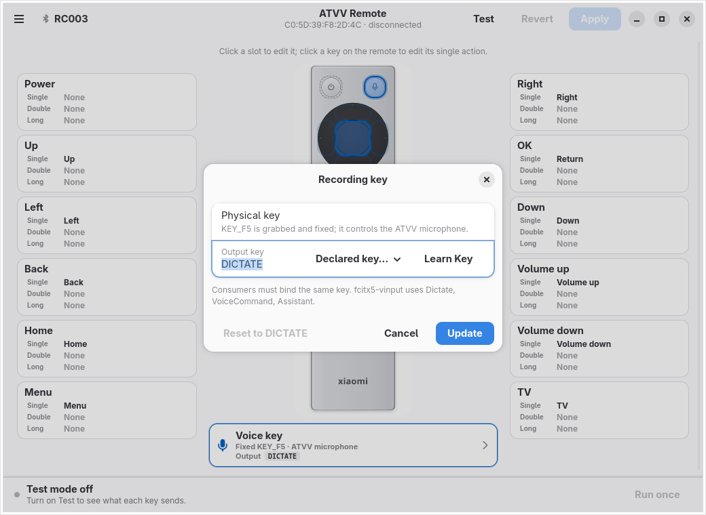

# 配置 GUI

[English](gui.md) | **简体中文**

`atvv-config` 是 `atvvd` 的 GTK4/libadwaita 配置客户端
（[ADR 0008](decisions/0008-gui-toolkit.md)）。它通过守护进程的
`GetConfig`/`SetConfig` API 编辑按键映射，并使用 `BeginCapture`/`RunAction`
进行测试模式。它从不写 `daemon.toml`、打开 evdev/uinput，或直接访问 BlueZ 或
PipeWire。



## 安装与启动

GUI 是可选的 `atvv-gui` AUR 软件包；守护进程软件包不依赖 GTK。

```sh
git clone https://aur.archlinux.org/atvv-gui.git
cd atvv-gui
makepkg -si
systemctl --user enable --now atvvd
atvv-config
```

先安装 `atvv`；`atvv-gui` 依赖它。AUR 助手会解析该依赖。

守护进程未运行时，窗口会打开只读的“守护进程不可用”页面，并提供“重试”按钮。
守护进程保持无界面；`atvvctl` 仍然是可脚本化的接口。

## 语言

应用跟随桌面语言环境。英文是默认值和回退值；任何 `zh*` 语言环境都会选择简体
中文。应用内没有语言切换。更改桌面语言后，请重启 `atvv-config`。

## 映射面板

窗口是围绕原始 RC003 矢量示意图的三列面板：

- 左侧卡片：电源、上、左、返回、主页、菜单。
- 中间：遥控器示意图和语音键卡片。
- 右侧卡片：右、确定、下、音量加、音量减、电视。

每张卡片显示三个手势槽位——**单击**、**双击**和**长按**——并以紧凑形式显示
解析后的操作（`Return`、`F13`、`Ctrl+Alt+V`、`Command…`、`Start dictation`
或 `None`）。选中的卡片和槽位使用系统强调色。无操作的槽位会变暗；同一手势下
与其他卡片发送相同操作的卡片会以琥珀色描边。

点击槽位即可编辑该槽位。点击示意图上的按键会选择对应卡片并编辑其**单击**槽位；
示意图和卡片始终显示同一选择。窗口窄于面板时，面板横向滚动；顶栏和测试栏保持
可见。

示意图右上角的语音键不是操作槽位。点击它，或示意图下方的**语音键**卡片，会打开
录音键对话框。

## 顶栏

- **菜单**：*设备信息…*、*还原更改*、*关于 ATVV* 和 *退出*。
- **设备标签**：配置文件型号（`RC003`）和电量。点击它打开只读的*设备信息*
  对话框，显示电池、遥控器地址以及设备信息服务事实（固件、硬件版本、软件版本、
  序列号、制造商、型号）。没有值的行会隐藏；断开连接时电量显示“上次值”。
- **测试**、**还原**和**应用**。

设备标签只针对当前活动设备。已知遥控器之间的切换和按设备区分的布局属于第 21
步，因此本步打开设备信息而不是设备列表。

## 编辑映射



1. 点击卡片槽位；若要点编辑示单击槽位，则点击示意图上的按键。**映射**对话框会
   针对该按键和手势打开，并显示该槽位是自定义映射、配置文件默认值还是未绑定。
2. 选择操作类型：
   - *无操作* 会吞掉按键（`none`）。
   - *单个按键* 发出一个按键，例如 `KEY_F13`。
   - *按键组合* 发出组合键，例如 `ctrl+alt+v`。
   - *运行命令* 通过守护进程运行 `exec:<command>`。
   - *听写* 启动、停止或切换 ATVV 麦克风。
3. 输入值或使用**学习按键**。学习时按住的修饰键会按 `ctrl`、`alt`、`shift`、
   `super` 的顺序成为组合键的一部分。
4. 点击**更新**。对话框关闭，面板显示新操作，顶栏的**应用**变为可用。

**学习遥控器…**会启动守护进程的捕获模式；按下遥控器实体按键会将对话框切换到该
按键和手势。**重置**会恢复该槽位的配置文件默认值；**取消**会丢弃对话框中的编辑。

**应用**会校验完整文档，将其应用到运行中的守护进程，并原子地写入文件。无效输入
会留在对话框中并显示内联错误，之前的映射保持活动。**还原**会重新加载守护进程
文档，丢弃未保存的编辑。

## 录音键

右上角的麦克风键是实体录音键（`KEY_F5`）。它被独占且固定：用于打开和关闭 ATVV
麦克风，不能作为普通操作按键。录音键对话框只编辑输出按键。



- **输出按键**是按住录音键时发出的合成按键。默认是 `DICTATE`；使用**学习按键**
  捕获其他按键或组合键（例如 `F23`），或输入 `none` 禁用合成按键。
- **声明键…**列出运行中守护进程契约声明的录音键（`DICTATE`、`VOICECOMMAND`、
  `ASSISTANT`）以及**无（禁用合成按键）**。列表来自
  `StatusView.contract.recording_keys`，不是 GUI 中的副本。选择条目会填入输出
  字段；正常的**更新**和**应用**路径仍负责校验和保存。
- 对话框显示消费者名称映射（fcitx5-vinput 使用 `Dictate`、`VoiceCommand`、
  `Assistant`），并在 `vinput` 为 `dbus` 或 `off` 时给出警告，因为这些模式
  不会发出合成按键。消费者必须绑定相同的按键；提供方契约的 `active_key` 报告
  当前值。
- **更新**修改文档；顶栏的**应用**通过 `SetConfig` 持久化。**重置为 DICTATE**
  恢复默认值。实体 F5 和 ATVV 麦克风路径保持不变。

## 测试模式

在顶栏切换**测试**。捕获激活期间，守护进程上报逻辑按键事件；被按下的卡片槽位会
高亮，底部栏显示按键、手势和解析后的操作，**运行一次**变为可用。捕获会抑制自动
按键/组合键发出、`exec`、听写、合成语音触发以及语音会话的开始/停止，因此按下
确定或音量键不会激活焦点应用或改变系统音量。语音键报告为固定；测试模式下不会
启动麦克风。Shell 命令需要单独的确认对话框，默认响应为取消。

关闭**测试**、点击横幅中的**取消**，或 GUI 的 D-Bus 连接消失时，捕获结束。GUI
从不读取输入设备；evdev 独占、操作映射和捕获状态由守护进程负责。

## 脚本安全

除非 `allow_exec = true`，否则 `exec:` 处于禁用状态。在操作对话框中开启**允许
shell 命令**；开启需要明确确认。守护进程以当前用户身份运行命令，超时 5 秒，
标准输入输出已关闭，一次只运行一条命令，并在有效 uid 为 0 时拒绝运行。GUI 不
解释 shell 语法；启用前请审查命令。

## 键盘与无障碍

每个卡片槽位都是可聚焦的 `GtkButton`，带有无障碍名称和工具提示。Tab 顺序遵循
面板；Enter 或空格打开聚焦的槽位。操作对话框打开时捕获焦点，关闭后将其还给
槽位；Enter 触发**更新**，Escape 取消。焦点环、系统浅色/深色主题和系统强调色
由 libadwaita 提供；示意图资源本身与主题无关。

## 持久化

守护进程将映射写入 `$XDG_CONFIG_HOME/atvv/daemon.toml`（默认
`~/.config/atvv/daemon.toml`）。同一文档可通过 `atvvctl config get --json`、
`atvv-mcp` 和守护进程的 D-Bus API 获取，因此 GUI 不是第二份事实来源。映射在
守护进程重启后仍然保留。

## 限制

- 一次一个设备配置文件；窗口显示守护进程上报的配置文件。
- 尚无布局选择或按设备布局（第 17、21 步）。面板遵循界面参考，但不包含布局
  标签、设备切换浮层、编辑器中的原始值预览行，以及卡片与示意图之间的连接线。
- 没有按应用分层的映射或自动快捷键发现。
- 应用内没有 ASR 或云协议；听写只驱动 ATVV 会话。
- GUI 是可选的。`atvvd`、`atvvctl`、`atvv-mcp` 以及 fcitx5-vinput 等消费者在
  没有 GUI 时仍可工作。
