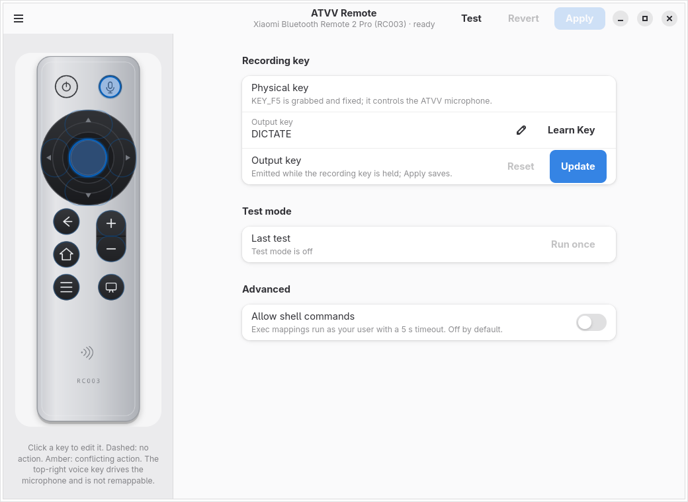

# 配置 GUI

[English](gui.md) | **简体中文**

`atvv-config` 是 `atvvd` 的 GTK4/libadwaita 配置客户端
（[ADR 0008](decisions/0008-gui-toolkit.md)）。它通过守护进程的
`GetConfig`/`SetConfig` API 编辑按键映射，并使用 `BeginCapture`/`RunAction`
进行测试模式。它从不写 `daemon.toml`、打开 evdev/uinput，或直接访问 BlueZ 或
PipeWire。


## 安装与启动

GUI 是可选的 `atvv-linux-gui-git` 软件包；守护进程软件包不依赖 GTK。

```sh
cd packaging/arch
makepkg -si
systemctl --user enable --now atvvd
atvv-config
```

本地 `-git` 软件包会替换发布包 `atvv-linux` 和 `atvv-linux-gui`。

守护进程未运行时，窗口会打开只读的“守护进程不可用”页面，并提供“重试”按钮。
守护进程保持无界面；`atvvctl` 仍然是可脚本化的接口。

## 语言

应用跟随桌面语言环境。英文是默认值和回退值；任何 `zh*` 语言环境都会选择简体
中文。应用内没有语言切换。更改桌面语言后，请重启 `atvv-config`。

## 窗口

- **遥控器示意图**：每个逻辑按键对应一个真实按钮，按 RC003 布局绘制：顶部是
  电源和语音键，中间是圆形方向键，左侧是返回/主页/菜单，右侧是音量键和 TV。
  右上角的语音键固定不变；它的输出按键可配置。点击按键进行编辑；轮廓显示已绑定
  （实线）、未绑定（虚线）和冲突（琥珀色）的映射。选中的按键使用系统强调色。
- **所选按键**：显示当前按键和手势。“学习…”会启动守护进程的捕获模式，并选择
  按下的实体遥控器按键。
- **操作**：所选槽位的类型、值和听写控制。“学习按键”无需离开窗口即可捕获键盘
  按键或组合键。
- **测试模式**：按下实体按键，查看将要运行的操作，并按需运行一次。
- **高级**：`allow_exec` 策略。

布局是 `AdwNavigationSplitView`：窄窗口下示意图和编辑器成为独立页面，选择热点
会打开编辑器。

## 设备状态

侧边栏主页以**电池**行开始，随后是遥控器示意图和**硬件**组。两者都是只读的：

- **电池**显示 BlueZ 缓存的遥控器电量百分比，并带有电量图标。遥控器断开时，
  最后已知值会标记为“上次值”；没有值时显示“未知”。
- **硬件**列出设备信息服务事实：固件、硬件版本、软件版本、序列号、制造商和
  型号。没有值的行会隐藏。

这些值来自守护进程 D-Bus API 的 `StatusView.hardware`；守护进程在连接期间每
60 秒刷新一次电池。GUI 本身从不访问 BlueZ。同一对象可通过 `atvvctl status` 和
`atvv-mcp status` 获取，`atvvctl doctor` 会打印一行摘要。

## 编辑映射

1. 在示意图中点击一个按键。
2. 选择**单击**、**双击**或**长按**。
3. 选择操作类型：
   - *无操作* 会吞掉按键（`none`）。
   - *单个按键* 发出一个按键，例如 `KEY_F13`。
   - *按键组合* 发出组合键，例如 `ctrl+alt+v`。
   - *运行命令* 通过守护进程运行 `exec:<command>`。
   - *听写* 启动、停止或切换 ATVV 麦克风。
4. 输入值或使用**学习按键**。学习时按住的修饰键会按 `ctrl`、`alt`、`shift`、
   `super` 的顺序成为组合键的一部分。
5. 点击**更新**，然后点击顶部的**应用**。

**应用**会校验完整文档，将其应用到运行中的守护进程，并原子地写入文件。无效输入
会留在编辑器中并显示内联错误，之前的映射保持活动。**重置**会恢复所选槽位的设备
配置文件默认值。**还原**会重新加载守护进程文档，丢弃未保存的编辑。

## 录音键

右上角的麦克风键是实体录音键（`KEY_F5`）。它被独占且固定：用于打开/关闭 ATVV
麦克风，不能作为普通操作按键。点击它会打开录音键页面；该页面只提供输出按键，
不提供手势/操作槽位。



- **输出按键**是按住录音键时发出的合成按键。默认是 `DICTATE`；使用**学习按键**
  捕获另一个按键或组合键（例如 `F23`），或输入 `none` 禁用合成按键。
- **更新**会修改文档；顶部的**应用**通过 `SetConfig` 持久化。实体 F5 和 ATVV
  麦克风路径不变。
- fcitx5-vinput 等消费者必须绑定相同的输出按键；提供方契约的 `active_key` 报告
  当前值。

## 测试模式

在顶部切换**测试**。捕获活动时，守护进程报告逻辑按键事件；窗口会高亮按下的按键，
显示解析后的操作，并启用**运行一次**。捕获会抑制自动按键/组合键发出、`exec`、
听写、合成语音触发和语音会话启动/停止，因此按下 OK 或音量键不会激活当前应用或
改变系统音量。语音键会报告为固定；在测试模式下它不会启动麦克风。shell 命令需要
单独的确认对话框，默认响应是“取消”。

当关闭测试、点击横幅中的**取消**，或 GUI 的总线连接消失时，捕获结束。GUI 从不
读取输入设备；守护进程拥有 evdev 独占、操作映射和捕获状态。

## 脚本安全

除非 `allow_exec = true`，否则 `exec:` 被禁用。在**高级**中启用它需要明确确认。
守护进程以用户身份运行命令，超时 5 秒，关闭 stdio，一次一条命令，并在有效 uid
为 0 时拒绝运行。GUI 不解释 shell 语法；启用前请检查命令。

## 键盘和可访问性

每个热点都是可聚焦的 `GtkButton`，带有可访问名称和工具提示。使用 Tab/Shift+Tab
在按键和编辑器之间移动，使用 Enter/Space 选择。焦点环、系统浅色/深色主题和系统
强调色来自 libadwaita；示意图资源本身与主题无关。

## 持久化

守护进程把映射写入 `$XDG_CONFIG_HOME/atvv/daemon.toml`（默认
`~/.config/atvv/daemon.toml`）。同一文档可通过 `atvvctl config get --json`、
`atvv-mcp` 和守护进程 D-Bus API 获取，因此 GUI 不是第二个事实来源。映射在守护
进程重启后仍然保留。

## 限制

- 一次只有一个设备配置文件；窗口显示守护进程报告的配置文件。
- 没有按应用分层或自动快捷键发现。
- 应用内没有 ASR 或云协议；听写只驱动 ATVV 会话。
- GUI 是可选的。`atvvd`、`atvvctl`、`atvv-mcp` 以及 fcitx5-vinput 等消费者
  无需它即可工作。
