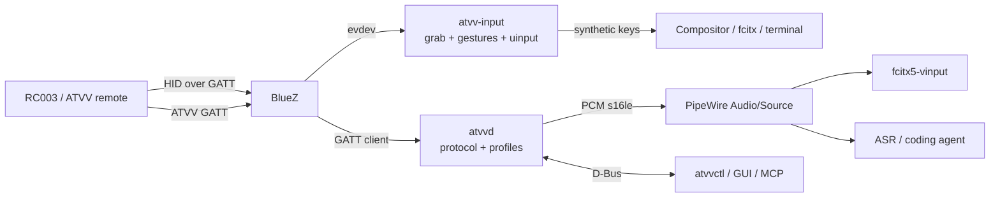

# ATVV on Linux: landscape and decisions

Status: research snapshot 2026-10-29; current deltas are in
[`README.md`](README.md). Source snapshots and licenses are in
[`reference-projects.md`](reference-projects.md). Wire facts are in
[`protocol-and-device.md`](protocol-and-device.md).

Scope: Xiaomi Bluetooth Remote 2 Pro / RC003, ATVV v1.0, Linux, BlueZ,
PipeWire, evdev/uinput. No RC003 was paired during this research, so no
hardware behavior is claimed.

## 1. Conclusions

1. **Do not write an ATVV kernel driver, a BlueZ plugin, or a PipeWire
   plugin.** ATVV is an application protocol over BLE GATT. BlueZ already owns
   pairing, GATT, and HID-over-GATT; PipeWire already owns user-space audio
   nodes; input uses evdev plus uinput. The correct boundary is a user-space
   daemon.
2. **ATVVoice is the best protocol/PipeWire reference, not a complete RC003
   product.** It separates BLE, session state, protocol codecs, PipeWire, and
   D-Bus, and has a substantial test suite. It lacks RC003 frame accumulation,
   `0x0A` sync handling, post-stop discard, RC003 keepalive/echo details,
   pairing, HID/buttons, configuration, and fcitx/agent integration.
3. **sayall-omarchy is the best RC003 field reference, not a reusable generic
   library.** It carries the useful RC003 quirks, evdev grab/uinput, gesture
   FSM, pairing agent, and a resident PipeWire source. It is tightly coupled to
   Omarchy, voxtype, Quickshell, RC003 assumptions, and an unofficial cloud ASR
   protocol.
4. **Extract behavior and data, not code.** The new stack needs a pure protocol
   crate, a BlueZ adapter, a native PipeWire source, an input/gesture layer, a
   D-Bus daemon, and a thin integration layer. Reuse MIT ideas with notices;
   do not copy GPL-3.0-only code.
5. **If the target were only RC003 + Omarchy + voxtype, sayall would be enough.**
   It is not enough for generic Linux, standard D-Bus, fcitx5-vinput, a
   configurable key tool, or a coding-agent integration. Those are the reasons
   for this project.

## 2. Where ATVV belongs

| Layer | Linux mechanism | Responsibility for ATVV | Write it? |
|---|---|---|---|
| Controller/kernel | `btusb`, HCI, `uhid`, `hid-generic`, evdev, uinput | BLE link, HID report to evdev, virtual input | No |
| BlueZ | system D-Bus, pairing/bonding, GATT client, HOG | Pairing, GATT read/write/notify, HID keyboard | No; only a GATT client |
| ATVV | `AB5E0001-5A21-4F05-BC7D-AF01F617B664` | Capability negotiation, mic open/close, ADPCM audio | Yes, user space |
| PipeWire | native `pw_stream` source, WirePlumber | Expose PCM as `Audio/Source` | Yes, one source node |
| Input | evdev + `EVIOCGRAB` + uinput | Intercept buttons, gestures, synthetic keys | Yes, one component |
| Integration | fcitx5-vinput D-Bus, MCP/CLI | ASR surface, text delivery, agent control | Yes, adapter layer |

### Why not a kernel driver

The old Android `hid-atv-remote.c` handled VoHoGP: audio was embedded in HID
reports, so a kernel HID driver could intercept it. ATVV audio travels on a
separate GATT characteristic and never enters HID. A kernel implementation
would need to duplicate BlueZ ATT/GATT, D-Bus, pairing, and ADPCM, with no
benefit. BlueZ issue #1086 has tracked this since 2025 without a kernel
solution.

### Why not a BlueZ plugin

BlueZ does not own the audio graph. An in-tree vendor plugin would still have
to hand PCM to PipeWire, would need upstream acceptance, and would be hard to
ship across distributions. A user-space daemon plus a systemd user service is
the standard boundary.

### Why not a PipeWire module

`module-pipe-source` is a FIFO/Pulse compatibility path with an extra process
and module lifecycle. `module-virtual-source` copies an existing source; it
does not produce PCM. The daemon should own a native `pw_stream` source with
`media.class=Audio/Source`.

## 3. Reference projects

### 3.1 ATVVoice

Snapshot: `b0o/ATVVoice`, `v0.2.0-13-g0e8f641`, MIT. See
[`reference-projects.md`](reference-projects.md).

Structure: `ble.rs` (bluer discovery/connection/characteristics/Philips vendor
handshake) → `atvv.rs` (session, keepalive, frame timeout, mic-on-demand) →
`protocol/` (v0.4/v1.0, codec negotiation, ADPCM) → `pw.rs` (native source) →
`dbus.rs` (MicOpen/MicClose/Toggle, state property and signals).

Useful:

- Clean protocol types (`TxOpcode`, `CtlOpcode`, `Codec`, `StreamId`,
  `InteractionModel`) and a large test suite.
- A compact D-Bus API that is a good model for a daemon boundary.
- Native PipeWire source; no PulseAudio compatibility layer.
- Nix, deb/rpm, and COPR packaging paths.
- Mic-on-demand link monitoring that accounts for monitor streams.

Gaps relative to RC003:

- No audio-characteristic `0x0A` sync, no cross-notification frame
  accumulator, no post-stop discard, no explicit RC003 `MIC_CLOSE` echo guard.
- `decode_audio` expects a notification to equal `frame_size`; MTU fragments or
  20-byte blocks are dropped.
- `MIC_OPEN` is short-only; `MIC_EXTEND` uses a stream id while RC003 uses the
  bare form.
- TX always uses Write Request; characteristic flags are not used to choose
  Write Command.
- Default gain is too high for RC003 16 kHz; source is created/destroyed with
  the connection, so consumer selection is unstable.
- No pairing agent, HID/buttons, configuration, or fcitx/agent integration.
- Open v1.0 edges: sequence gaps, cannot stop mic, audio sometimes does not
  start, source disappears after a PipeWire restart.

Verdict: best protocol and PipeWire reference; not a complete RC003 daemon.

### 3.2 sayall-omarchy

Snapshot: `fan-tastic-z/sayall-omarchy`, `4d10971`, MIT per `Cargo.toml`. See
[`reference-projects.md`](reference-projects.md).

Structure (about 8.2k lines of Rust):

- `sayall-core`: ADPCM with nibble order, frame accumulator, PCM
  post-processing, gesture FSM, hold-to-talk, button map.
- `sayall-atvv`: bluer GATT, RC003 session, CAPS, audio pipeline (`0x0A` sync,
  CAPS on audio, post-stop discard), MIC_OPEN variants/watchdog, MIC_EXTEND,
  reconnect.
- `sayall-pipewire`: native source plus FIFO fallback, about 2 seconds of
  buffering, resident source.
- `sayall-hid`: evdev discovery/grab, keycode map, uinput keyboard, debug.
- `sayall-asr`: unofficial Doubao cloud ASR (WebSocket + protobuf + Opus).
- `sayall`: daemon orchestration, voxtype signals, state file, Unix socket IPC,
  CLI, pairing agent, minimal MCP, Quickshell plugin.

Useful RC003 facts:

- Direct `AUDIO_START` with no `START_SEARCH`.
- `MIC_CLOSE` echo can drive a self-excited close loop.
- `AUDIO_START` payload codec is not trustworthy; CAPS wins.
- 16 kHz, 0 dB, `0x0A` sync, 300 ms post-stop discard, stable-release latch.
- F5 is grabbed and synthesized through uinput; `wtype` did not trigger
  Hyprland binds.
- Pairing agent auto-confirms LE Secure Connections numeric comparison.

Gaps:

- Hard-coded RC003 identity, 16 kHz, 120-byte frames, Omarchy shortcuts,
  Quickshell, and voxtype.
- No v0.4/v1.0 dispatch; unknown devices can be misparsed.
- Source rate is fixed at 16 kHz; an 8 kHz codec would play at the wrong speed.
- Grabs every matching evdev node, which can break air-mouse/gyro devices.
- Voice key only drives voxtype/Doubao; no generic trigger/D-Bus/MCP surface.
- Doubao ASR is an unofficial protocol, uploads audio, and can break; it does not
  belong in the core.
- IPC is a custom Unix socket, not standard D-Bus.
- The MCP surface is a minimal JSON-RPC proxy, not full MCP.
- Setup enables BlueZ experimental features, uses an `audio` group, and has a
  broad D-Bus policy; these are not the clean defaults.

Verdict: best RC003 product reference; extract field knowledge, not the
Omarchy/voxtype/Doubao assumptions.

### 3.3 remote-mic-app (macOS)

Snapshot: `HD838A/remote-mic-app`, `v2.0.0-470-gdec29b88`, GPL-3.0-only. Use
documentation and behavior only; do not copy code or resources.

It is the most complete feature reference: 16 kHz ATVV, frame accumulation,
sync, post-processing, gain, pre-roll/drain, Fn/Command trigger modes, custom
button mapping, application focus, test tone, statistics, and updates.

Its virtual audio driver is a macOS workaround: CoreAudio has no native
virtual source, so it derives BlackHole and presents a USB transport. Linux
does not need this layer; PipeWire provides the source directly. Its HID raw
report/IOHID path is also macOS-specific; Linux uses BlueZ HOG plus evdev.

Reusable ideas: hold/tap trigger semantics, pre-roll, drain, a mapping UI, and
permission/privacy boundaries. Not reusable: code, driver, HID mapping, and
platform focus hacks.

### 3.4 Open Voice Bridge

Prior art for a six-layer architecture: device identity/capability, transport,
device protocol, audio graph, action mapping, and platform backend, with a JSON
device-profile schema. It is macOS/Windows-oriented; Linux is planned/research.
Its profile is a fact directory, not a driver. The principle “do not abstract
ahead of a second working device” is worth keeping. GPL-3.0: read the schema
and architecture, do not copy code.

### 3.5 fcitx5-vinput

The preferred Linux ASR/TTS surface. It is a separate GPL-3.0 process; the
daemon integrates over D-Bus and by selecting the ATVV source by name. It
captures 16 kHz mono S16LE, defaults to `Alt_R` for tap/hold, and can keep a
bounded warm stream. The interface and integration rules are in
[`protocol-and-device.md`](protocol-and-device.md) §8.

### 3.6 Comparison

| Dimension | ATVVoice | sayall-omarchy | remote-mic-app |
|---|---|---|---|
| Platform | Linux | Linux/Omarchy | macOS |
| ATVV versions | v0.4 + v1.0 | RC003 v1.0 style | v1.0 |
| 16 kHz | Yes | Yes | Yes |
| RC003 quirks | Few | **Most complete** | Complete on macOS |
| PipeWire | Native, connection-scoped | Native, resident | CoreAudio + BlackHole |
| HID/buttons | No | evdev + uinput + gestures | IOHID + mapping |
| Pairing | Manual | Auto-confirm agent | CoreBluetooth |
| Config/UI | CLI + Nix | TOML + Quickshell | Full GUI |
| ASR | None | voxtype / Doubao | External |
| D-Bus | Mic API | No, custom socket | No |
| Tests | 96 (snapshot) | 99 (snapshot) | Swift tests |
| License | MIT | MIT (Cargo) | GPL-3.0-only |

## 4. Extraction matrix

| Component | Best source | What to take | What must be added |
|---|---|---|---|
| ATVV protocol | ATVVoice | Pure protocol/ADPCM/frame split, typed events | RC003 sync, accumulator, discard, echo, profile |
| BLE GATT | sayall-atvv + ATVVoice | Discovery, connect, notify, reconnect | Pairing agent, characteristic flags, AcquireNotify fallback |
| PipeWire source | sayall + ATVVoice | Native source, resident node, queue | `node.virtual`, codec rate, node-removal recovery, systemd restart |
| HID/grab/uinput | sayall-hid | `EVIOCGRAB`, keycodes, uinput | Grab only keyboard/consumer node; full forwarding |
| Gestures/mapping | sayall-core | Gesture FSM, timing constants | Generic action grammar, profile defaults, per-device map |
| Pairing | sayall | LE SC auto-confirm agent | Target-device-only confirmation, failure guidance |
| D-Bus API | ATVVoice | Simple mic methods/signals | Device/state/button/voice events, stable view model |
| Config | sayall-config | TOML validation, defaults | Profile schema, hot reload, comments preservation |
| ASR | sayall/remote-mic-app | Behavior only | External fcitx/vinput/sherpa; never Doubao in core |
| MCP | sayall | Tool names as prior art | Full `initialize`/`tools/list`/`tools/call` |
| UI | sayall/remote-mic-app | Mapping interaction ideas | Optional CLI/TUI first; no Quickshell coupling |
| Profiles | Open Voice Bridge | Fact-directory idea | Linux transport fields; original schema |

## 5. Recommended architecture



Workspace direction:

```text
crates/
  atvv-protocol/   pure ATVV v1.0, ADPCM, frames, profiles, session FSM
  atvv-bluez/      GATT client, discovery, pairing agent, reconnect
  atvv-audio/      PipeWire source, bounded queue, node lifecycle
  atvv-input/      evdev, grab, gesture FSM, uinput, keymap
  atvv-daemon/     orchestration, D-Bus, mock transport
  atvv-cli/        atvvctl diagnostics and control
  atvv-mcp/        optional stdio MCP
packaging/         systemd, udev, modules-load
docs/
```

Seams:

- `DeviceProfile` is data: matching, codec, frame size, nibble order, command
  variants, stop echo, discard window, sample rate, gain, keys.
- `Session` is pure and clock-free; it emits commands/events. The daemon owns
  timers and transports.
- `CAPS_RESP` is authoritative for codec and frame size. `AUDIO_START` payload
  bytes are an event, not a codec source.
- One source per device; source state survives a disconnected remote.
- D-Bus is the stable integration boundary; protocol types do not leak into it.

## 6. Integration boundary

### fcitx5-vinput

Preferred trigger: grab the voice key and synthesize a configurable key
(`Alt_R` by default) on press/release. The fcitx input-context path then owns
recording, ASR, and text commit. D-Bus `StartRecording`/`StopRecording` is the
fallback, not the primary path. Do not open the remote mic merely because a
PipeWire consumer is linked; drive mic open/close from ATVV events. Exact
interface: [`protocol-and-device.md`](protocol-and-device.md) §8.

### Coding agents

Do not use global `wtype` text injection as the core. The daemon exposes voice
events, button events, and a source; an adapter chooses `tmux send-keys`,
WezTerm/Kitty send-text, clipboard paste, or the agent's own API. MCP is for
start/stop/status/mapping, not a streaming audio transport.

### ASR boundary

The daemon does not contain ASR. Use fcitx5-vinput, voxtype, sherpa, or an
external adapter. Unofficial cloud protocols, including Doubao, stay out of the
core.

## 7. Project-level risks

| Risk | Symptom | Response |
|---|---|---|
| Treating ATVV as HID | Searching for audio in hidraw | ATVV is a separate GATT service; HID only carries buttons |
| Copying GPL-only code | License contamination | MIT references with notices; GPL references behavior-only |
| Connection-scoped source | fcitx device selection disappears | Resident source; node removal recovery |
| Fixed 16 kHz source | 8 kHz devices play at wrong speed | Rate follows negotiated profile; v1.0-only now |
| Consumer-driven mic open | Warm stream keeps mic open | Event-driven mic control |
| Grabbing all evdev nodes | Air-mouse/gyro broken | Grab keyboard/consumer node only |
| Broad D-Bus/BlueZ policy | Security and portability debt | No policy by default; minimal only when required |
| Hardware claims from mocks | False support claim | Step 07 evidence file; no device, no claim |

## 8. Verification checklist

Research evidence:

- ATVVoice snapshot: 96 tests passed (recorded 2026-10-29).
- sayall-omarchy snapshot: 99 tests passed (recorded 2026-10-29).
- No RC003 hardware was paired; no local audio/button verification.

Real-device acceptance belongs to step 07 and step 09: CAPS bytes, 16 kHz WAV,
key map, fcitx output, reconnect, PipeWire restart, and 60-second keepalive.

## 9. References

Exact URLs, pinned commits, licenses, and upstream links:
[`reference-projects.md`](reference-projects.md).
